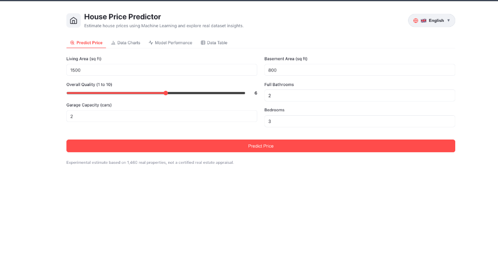
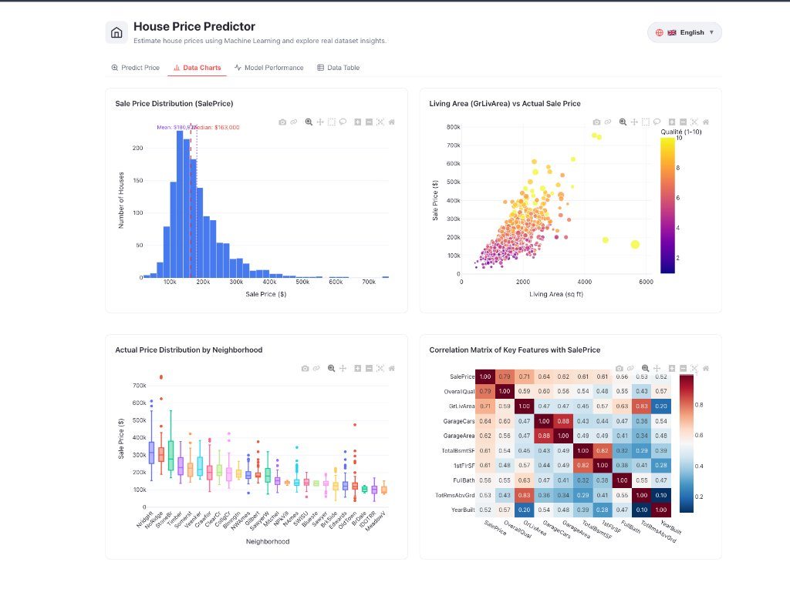
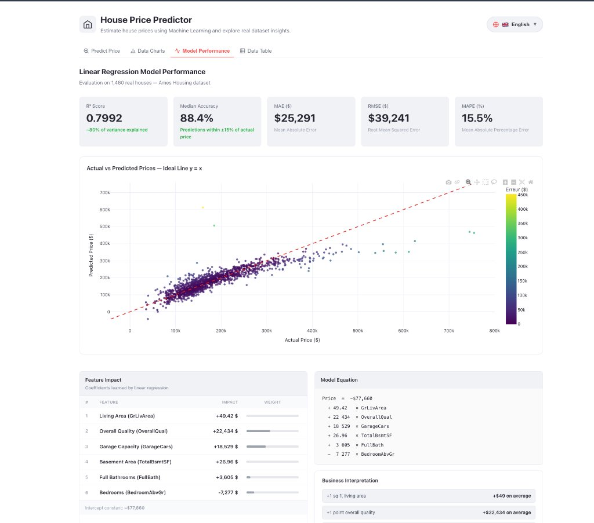
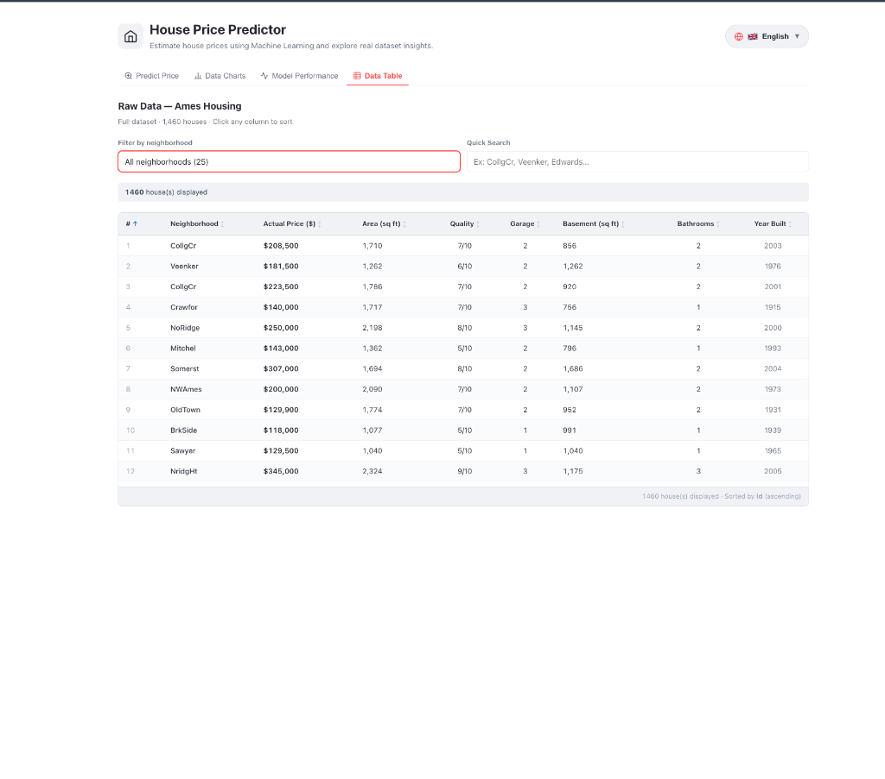

# House Price Prediction — Machine Learning

A complete end-to-end machine learning project that predicts residential house prices using **Linear Regression**, built with a production-grade Python backend (FastAPI) and a professional React dashboard.

[](https://www.python.org/)
[](https://fastapi.tiangolo.com/)
[](https://react.dev/)
[](https://scikit-learn.org/)
[](https://github.com/Amir-hissein/House-price-ml)
[](LICENSE)

---

## 🖼️ Application Showcase

| 🔮 **Price Predictor** | 📊 **Interactive Data Charts** |
| :---: | :---: |
|  |  |
| *Real-time inference & market percentile* | *Plotly distributions & correlation heatmap* |
| 📈 **Model Performance & Interpretability** | 🗂️ **Raw Data Explorer (1,460 Homes)** |
|  |  |
| *R², actual vs predicted scatter plot & equation* | *Sortable table with sticky header & filters* |

---

## Overview

This project covers the full ML lifecycle — from raw data ingestion to an interactive web interface — using the **Ames Housing dataset** (1,460 houses). It is designed to be clean, testable, and easy to run locally.

| Metric | Value | Interpretation |
|---|---|---|
| **R² Score** | **0.7992** | Explains ~80% of price variance with 6 key features |
| **Median Accuracy** | **88.4%** | Half of predictions are within ±11.6% of real price |
| **MAE** | **\$25,291** | Mean absolute dollar error across the test set |
| **RMSE** | **\$39,241** | Root mean squared error penalizing large deviations |
| **MAPE** | **15.5%** | Average relative percentage error |

---

## Key Features

- **Linear Regression Pipeline** trained on 6 key drivers (`GrLivArea`, `OverallQual`, `GarageCars`, `TotalBsmtSF`, `FullBath`, `BedroomAbvGr`)
- **FastAPI Backend** — High-performance REST API (`/predict`, `/metrics`, `/data`, `/plotly/*`)
- **Modern React 18 Dashboard** — Streamlit-inspired minimalist design with full responsive support
- **🌐 100% Multi-Language (i18n)** — One-click floating language picker supporting **Français 🇫🇷**, **English 🇬🇧**, and **Türkçe 🇹🇷** (including chart axes and annotations)
- **Interactive Plotly Visualizations** — Zoom, hover tooltips, distributions, box plots, and heatmaps
- **Automated Test Suite** — 26 pytest tests covering API endpoints, data loading, preprocessing, model training, and visualization
- **One-Command CLI Runner** — `run.sh` script to launch, train, test, and audit with zero hassle

---

## Project Structure

```
house-price-ml/
├── api/
│   └── main.py               # FastAPI app — /predict, /metrics, /data, /charts
├── frontend/                 # React + Vite dashboard
│   ├── src/
│   │   ├── components/       # Tab components (Predictor, Charts, Model, Data)
│   │   ├── services/api.js   # HTTP client for FastAPI
│   │   └── App.jsx
│   └── package.json
├── src/
│   ├── data_loader.py        # Hugging Face dataset download & CSV loading
│   ├── preprocessing.py      # ColumnTransformer pipeline
│   ├── train.py              # Model training & serialization
│   ├── evaluate.py           # Test-set evaluation (R², MAE, RMSE, MAPE)
│   ├── predict.py            # Single-sample inference
│   └── visualize.py          # Plotly chart generation
├── data/raw/                 # Raw dataset (auto-downloaded)
├── models/
│   └── linear_regression.joblib
├── reports/
│   ├── metrics.json
│   └── figures/
├── tests/                    # 26 automated pytest tests
├── run.sh                    # Universal launcher script
├── requirements.txt
└── README.md
```

---

## Quick Start

### Prerequisites

- Python 3.10+
- Node.js 18+ (for the React frontend)

### 1. Clone the repository

```bash
git clone https://github.com/Amir-hissein/House-price-ml.git
cd House-price-ml
```

### 2. Set up the Python environment

```bash
python3 -m venv venv
source venv/bin/activate        # Windows: venv\Scripts\activate
pip install -r requirements.txt
```

### 3. Build the frontend

```bash
cd frontend
npm install
npm run build
cd ..
```

### 4. Train the model

```bash
./run.sh train
```

### 5. Launch the app

```bash
./run.sh app
```

Open **http://localhost:8000** in your browser.

---

## Available Commands

```bash
./run.sh app          # Start the FastAPI server + React frontend (port 8000)
./run.sh train        # Retrain the model and regenerate charts
./run.sh test         # Run the full pytest test suite (26 tests)
./run.sh predict      # Run a sample prediction from the command line
./run.sh visualize    # Export interactive HTML charts to reports/figures/
./run.sh audit        # Run the model & chart audit control script
```

---

## API Endpoints

| Method | Endpoint | Description |
|---|---|---|
| `POST` | `/predict` | Predict price from house features |
| `GET` | `/metrics` | Model evaluation metrics (R², MAE, RMSE…) |
| `GET` | `/data` | Full dataset as JSON |
| `GET` | `/plotly/{chart}` | Plotly figure JSON for interactive charts |

Interactive API docs available at **http://localhost:8000/docs**

---

## Model Details

The model is a **scikit-learn Linear Regression** trained on 6 features:

| Feature | Description | Coefficient |
|---|---|---|
| `GrLivArea` | Above-ground living area (sq ft) | +\$49 / sq ft |
| `OverallQual` | Overall material & finish quality (1–10) | +\$22,434 / point |
| `GarageCars` | Garage capacity (vehicles) | +\$18,529 / car |
| `TotalBsmtSF` | Total basement area (sq ft) | +\$27 / sq ft |
| `FullBath` | Full bathrooms above grade | +\$3,605 / bath |
| `BedroomAbvGr` | Bedrooms above grade | –\$7,277 / room |

**Intercept:** –\$77,660

---

## Tech Stack

| Layer | Technology |
|---|---|
| ML | scikit-learn, pandas, numpy |
| Backend | FastAPI, uvicorn, joblib |
| Frontend | React 18, Vite, Plotly.js |
| Data | Hugging Face Datasets (Ames Housing) |
| Testing | pytest |
| Visualization | Plotly (interactive) |

---

## License

This project is licensed under the **MIT License** — see the [LICENSE](LICENSE) file for details.
